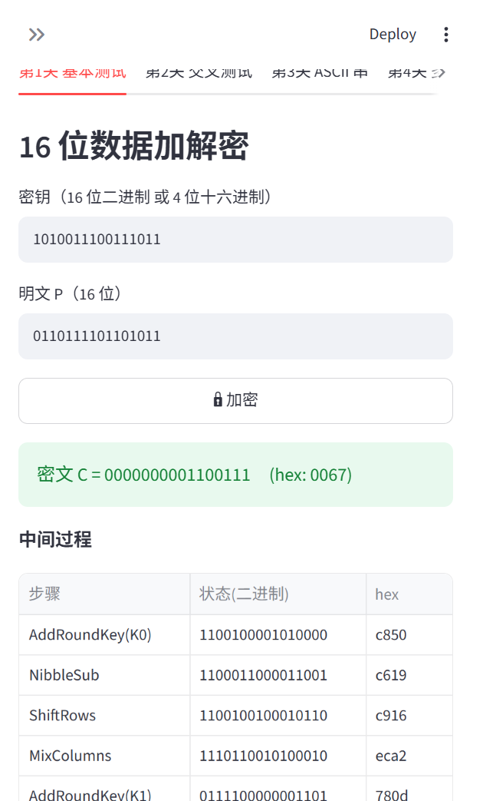
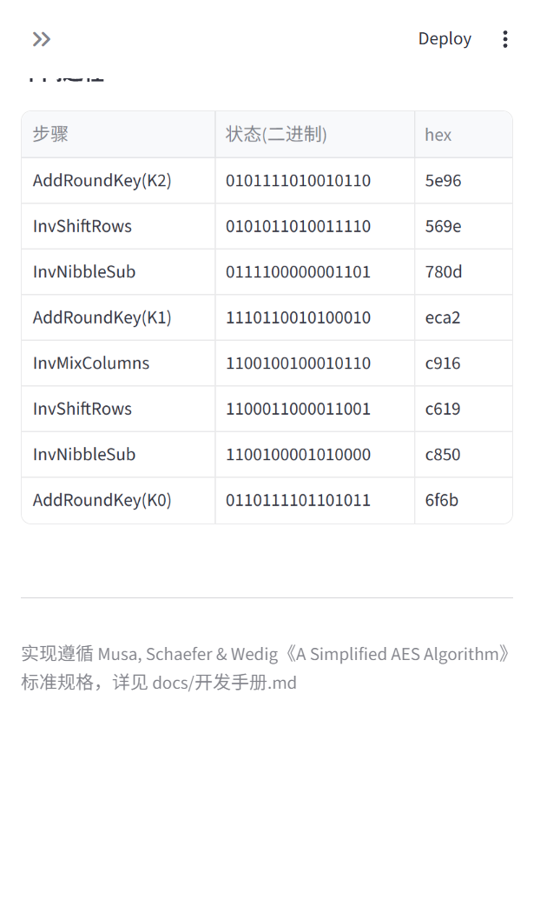

# S-AES 加解密系统 · 测试报告

- **测试日期**：2026-10-20
- **测试环境**：Windows 10/11 · Python 3.13.16 · 纯标准库（GUI 另需 Streamlit）
- **被测对象**：`saes.py`（算法核心）、`cli.py`（命令行）、`gui.py`（图形界面）
- **测试执行**：`python run_tests.py`（可重复，随机种子固定）

## 1. 结论

**34 / 34 项测试全部通过，课程四个关卡全部通关。**

| 关卡 | 测试项数 | 结果 |
|---|---|---|
| 第 0 部分 单元自检 | 6 | ✅ 全部通过 |
| 第 1 关 基本测试 | 5 | ✅ 全部通过 |
| 第 2 关 交叉测试 | 2 + 向量表 | ✅ 全部通过 |
| 第 3 关 ASCII 扩展 | 9 | ✅ 全部通过 |
| 第 4 关 多重加密 | 12 | ✅ 全部通过 |

## 2. 第 1 关：基本测试

| 用例 | 结果 | 关键数据 |
|---|---|---|
| 标准向量 E(0x6F6B, 0xA73B) | ✅ | C = 0x0067 = `0000000001100111` |
| 标准向量解密还原 | ✅ | D(0x0067) = 0x6F6B |
| 随机 2000 组加解密可逆 | ✅ | E→D 全部还原 |
| 固定密钥加密为双射 | ✅ | 65536 明文 → 65536 个不同密文 |
| trace 中间状态 | ✅ | 8 步：AK(K0)→NS→SR→MC→AK(K1)→NS→SR→AK(K2) |

GUI 交互验证（浏览器实测）：加密、解密按钮均正确显示结果与中间过程表。
截图： ｜ 

## 3. 第 2 关：交叉测试（标准向量表）

供与其他小组在异构平台比对；相同 P、K 必得相同 C，解密可还原 P：

| P (bin) | K (bin) | C (bin) | P(hex) | K(hex) | C(hex) |
|---|---|---|---|---|---|
| 0110111101101011 | 1010011100111011 | 0000000001100111 | 6f6b | a73b | 0067 |
| 0000000000000000 | 0000000000000000 | 0000101110001011 | 0000 | 0000 | 0b8b |
| 1111111111111111 | 1111111111111111 | 1111101011111011 | ffff | ffff | fafb |
| 0000000100100011 | 0100010101100111 | 1001100001011101 | 0123 | 4567 | 985d |
| 1010101111001101 | 1110111100000001 | 1101000011011100 | abcd | ef01 | d0dc |
| 0001001000110100 | 0000000000000000 | 0101000111010111 | 1234 | 0000 | 51d7 |
| 0000000000000000 | 0001001000110100 | 1101111001101101 | 0000 | 1234 | de6d |
| 1010101010101010 | 0101010101010101 | 0111001100101110 | aaaa | 5555 | 732e |

8 组标准向量 + 12 组随机向量加解密一致性全部通过。交叉测试方法与不一致排查步骤见《用户指南》§6、FAQ。

## 4. 第 3 关：ASCII 字符串加密

密钥 K = 0x3A94，分组 2 字节，PKCS#7 填充：

| 明文 | 字节数 | 密文（乱码，latin-1 呈现） | 解密还原 | 结果 |
|---|---|---|---|---|
| `Hello, S-AES!` | 13 | `\x9f«¬\x86¥\x96\x7fÓ¦TÆɶ` | 原文一致 | ✅ |
| `Information Security` | 20 | `¾ï\x18\x0fºÛ{Í\x1eïÍ\x02eöY\x99ÊÞÁN\x17¦` | 原文一致 | ✅ |
| `S-AES 123` | 9 | `Ç7\x97\x0b74(Ð\x1b\x1b` | 原文一致 | ✅ |
| `A`（奇数长度填充） | 1 | `I³` | 原文一致 | ✅ |
| ``（空串） | 0 | `\x17¦` | 原文一致 | ✅ |
| `信息安全导论`（UTF-8 扩展） | 18 | `]Ì\x0e¦*\x9eõ}Æñ\x95yU\|sÏh?\x17¦` | 原文一致 | ✅ |
| `hi~` | 3 | `\x0f\xa0?É` | 原文一致 | ✅ |

附加验证：密文与原文不同（乱码）✅；错误密钥解密结果异于原文 ✅。

## 5. 第 4 关：多重加密

### 5.1 双重加密（32 位密钥）

- 随机 500 组（P，K32）可逆性 ✅
- 示例：K1=0xA73B, K2=0x6F6B, P=0x6F6B → C=0x2F63，解密还原 ✅
- 双重加密结果异于两次单重（任意 K1/K2 单独加密）✅

### 5.2 中间相遇攻击

真实密钥 K1=0x2D55, K2=0x0F1E（32 位密钥 `0010110101010101 0000111100011110`）：

| 已知明密文对数 | 候选数 | 是否含正确密钥 | 耗时 | 结果 |
|---|---|---|---|---|
| 1 组 | 65490 | ✅ | 1.59 s | ✅ |
| 2 组 | 2 | ✅ | 3.13 s | ✅ |
| 3 组 | **1（唯一）** | ✅ | 3.04 s | ✅ |

- 候选数随对数收敛符合理论（期望 2¹⁶ → ≈1 → 唯一），见《开发手册》§4.3。
- 用恢复密钥加密新明文与真实密钥完全一致 ✅（P=0xA7E5 验证）。
- 随机 10 轮完整攻击演练（各 3 组对）全部唯一恢复 ✅。

### 5.3 三重加密

| 方案 | 密钥 | 示例（P=0x6F6B） | 随机可逆 | 结果 |
|---|---|---|---|---|
| EDE（32 位） | K1=0xA73B, K2=0x6F6B | C = 0x3D2C | 各 300 组 ✅ | ✅ |
| EEE（48 位） | K1=0xA73B, K2=0x6F6B, K3=0x3A94 | C = 0x77C3 | 同上 ✅ | ✅ |

三重加密结果异于双重与单重加密 ✅。

## 6. GUI 交互验证（浏览器实测）

| 步骤 | 结果 |
|---|---|
| 页面加载、四个标签页渲染 | ✅ |
| 第 1 关加密：C = 0000000001100111 (0067) 与中间过程表 | ✅ [截图](screenshots/step3-encryption-result.png) |
| 第 1 关解密：P = 0110111101101011 (6f6b) | ✅ [截图](screenshots/step5-decryption-result.png) |
| 第 4 关中间相遇攻击：3.389 s 找到候选密钥 | ✅ [截图](screenshots/step6-met-in-middle-attack-result.png) |

## 7. 单元自检明细（第 0 部分）

| 用例 | 结果 |
|---|---|
| 逆 S 盒 = S 盒的逆（16 项全覆盖） | ✅ |
| S 盒为双射 | ✅ |
| GF(2⁴) 乘法抽查：4·9=2；2·9=1；4·4=3；9·9=D；3·E=1；4·D=1 | ✅ |
| GF(2⁴) 逆元自洽 a·a⁻¹=1（15 项） | ✅ |
| InvMixColumns∘MixColumns = id（65536 状态全覆盖，0.84 s） | ✅ |
| 密钥扩展手工推演比对（K=0xA73B → K1=94AF, K2=5EF1） | ✅ |

## 8. 附：完整原始输出

见 [测试报告_原始输出.txt](测试报告_原始输出.txt)。
